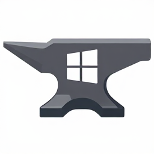
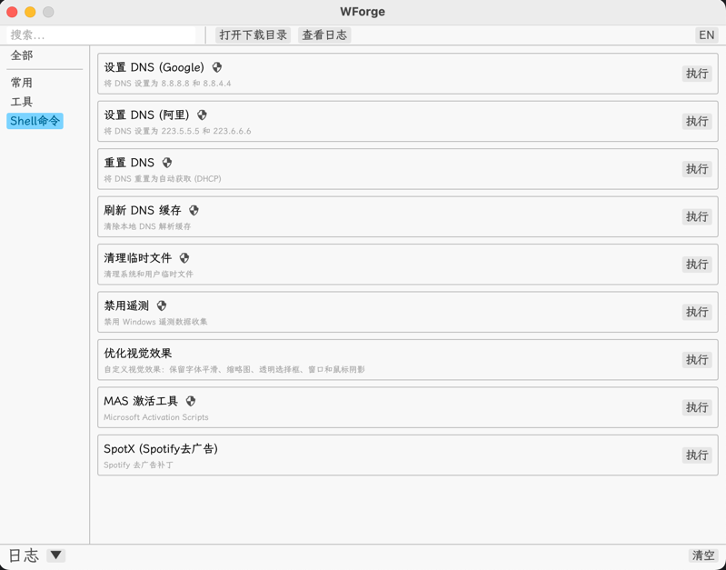

<p align="center">
  
</p>

<h1 align="center">WForge</h1>

<p align="center">
  <strong>Windows 装机工具箱 - 单文件、便携、开箱即用</strong>
</p>

<p align="center">
  
  
  
  
  
</p>

---

## 图例

<p align="center">
  
</p>

---

## 特性

- **便携** - 单个 `.exe` 文件，U盘或任意位置直接运行
- **下载** - 直链下载，显示进度和速度，支持取消
- **自动更新** - 从 GitHub Release 获取最新版本
- **Shell 命令** - 内置常用系统优化脚本，一键执行
- **双语** - 中英文界面切换
- **日志** - 内置日志查看器，方便排查问题

---

## 使用方法

1. 从 [Releases](https://github.com/lyon-le/WForge-release/releases) 下载 `WForge.exe`
2. 双击运行，无需安装
3. 下载的文件保存在用户 `Downloads` 目录

---

## 从源码构建

在 Windows 上安装 [Rust（rustup）](https://rustup.rs/) 和 [Visual Studio Build Tools](https://visualstudio.microsoft.com/visual-cpp-build-tools/)，并在 Build Tools 中选择「使用 C++ 的桌面开发」（包含 MSVC 工具链和 Windows SDK）。

在仓库根目录运行：

```powershell
rustup target add x86_64-pc-windows-msvc
cargo build --locked --release --target x86_64-pc-windows-msvc
```

生成的单文件程序位于 `target\x86_64-pc-windows-msvc\release\wforge.exe`。

项目采用 [MIT 许可证](LICENSE)；内置的霞鹜文楷轻便版（LXGW WenKai Lite）字体采用 [SIL Open Font License 1.1](assets/OFL-LXGWWenKaiLite.txt)。

---

## 内置软件

### 常用

| 软件 | 说明 |
|------|------|
| Google Chrome | Chrome 浏览器 |
| QQ | QQ PC 客户端 |
| 微信 | 微信 PC 客户端 |
| Steam | Steam 游戏平台 |
| TeamSpeak3 | TeamSpeak 语音客户端 |

### 工具

| 软件 | 说明 |
|------|------|
| 7-Zip | 压缩工具 |
| VS Code | 代码编辑器 |
| Everything | 文件搜索工具 |
| Snipaste | 截图贴图工具 |
| Clash Verge | 代理工具 |
| 火绒安全 | 安全软件 |
| Space Sniffer | 磁盘分析工具 |
| Steam++ | Steam 加速工具 |
| 图吧工具箱 | 硬件检测工具箱 |
| Office Tool Plus | Office 部署工具 |

---

## Shell 命令

### DNS 设置

| 命令 | 说明 |
|------|------|
| 设置 DNS (Google) | 将 DNS 设置为 `8.8.8.8` 和 `8.8.4.4` |
| 设置 DNS (阿里) | 将 DNS 设置为 `223.5.5.5` 和 `223.6.6.6` |
| 重置 DNS | 将 DNS 重置为自动获取 (DHCP) |
| 刷新 DNS 缓存 | 清除本地 DNS 解析缓存 |

### 系统优化

| 命令 | 说明 |
|------|------|
| 清理临时文件 | 清理系统和用户临时文件 |
| 禁用遥测 | 禁用 Windows 遥测数据收集 |
| 优化视觉效果 | 保留字体平滑、缩略图、透明选择框、窗口和鼠标阴影 |

### 其他工具

| 命令 | 说明 |
|------|------|
| MAS 激活工具 | Microsoft Activation Scripts |
| SpotX | Spotify 去广告补丁 |

---

## 系统要求

- Windows 10 或更高版本

> **提示**：若使用 LTSC 或精简系统无法启动，请以管理员身份运行 `wsreset -i` 安装 Microsoft Store 后重试。

---

## Star History

<p align="center">
  <a href="https://star-history.com/#lyon-le/WForge-release&Date">
    
  </a>
</p>

---

## 反馈

如有问题或建议，请在 [Issues](https://github.com/lyon-le/WForge-release/issues) 提交。
